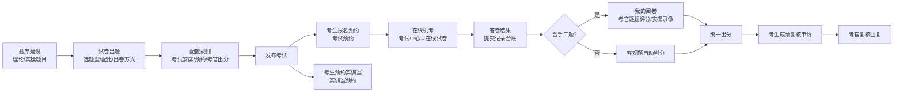

# 考试系统 · 产品设计文档

> 文档版本：v1.0　|　编制日期：2026-10-08　|　适用范围：医学教育培训考试系统（培训 / 考试 / 理论实操练习一体化）
> 技术栈：React 18 + TypeScript + Vite + Ant Design 5 + dayjs　|　子系统主题色：`#eb2f96`
> 代码位置：`src/components/exam/`（11 个页面组件）+ `src/config/apps.tsx`（菜单注册）

---

## 一、系统定位与目标

**一句话定位**：面向医院医务科 / 教学科的一体化**教育培训考试平台**，覆盖「题库建设 → 试卷出题 → 报名预约 → 在线机考 / 现场实操 → 阅卷评分 → 成绩出分 → 成绩复核」的完整闭环。

**要解决的核心问题**

| 痛点 | 本系统的应对 |
|------|--------------|
| 理论考试组织繁琐、组卷慢 | 四种出题方式（统一 / AB 组卷 / 千人千卷 / 手工），支持难度、分类配比，系统自动按比抽题 |
| 实操考核（OSCE）评分主观、难追溯 | 实操题两级评分表（评分项目 + 评分细则），多考官独立打分取均值，支持现场录像留证 |
| 考场、实训室资源冲突 | 实训室管理 + 预约日历 + 签到状态跟踪，名额与时段可控 |
| 考生成绩异议无沉淀 | 成绩复核线上申请 → 考官复核回复 → 状态留痕 |
| 考生考前不知考什么、怎么考 | 准考证（含考场 / 座位号）、考生须知（Word 式富文本），可打印下载 |

**双视角设计**：同一套界面按菜单承担两种角色职责——
- **考生视角**：考试中心、考试预约、实训室预约（以「我的」数据为主）；
- **管理 / 考官视角**：试卷出题、理论 / 实操题目、答卷结果、我的阅卷、实训室管理、评分项目。

---

## 二、信息架构（菜单树）

```
考试系统（exam，主题色 #eb2f96）
├── 工作台                      exam-dashboard              ⚠️ 建设中
├── 培训管理                    exam-training               ⚠️ 建设中
├── 考试管理
│   ├── 考试中心                exam-center        ← ExamCenter.tsx（考生：我的考试）
│   ├── 考试预约                exam-booking       ← ExamBooking.tsx（考生：报名场次）
│   ├── 答卷结果                exam-marking       ← MarkingHall.tsx  scope=all
│   ├── 我的阅卷                exam-my-marking    ← MarkingHall.tsx  scope=mine
│   ├── 理论题目                exam-questions     ← QuestionBank.tsx scope=theory
│   ├── 实操题目                exam-practical-questions ← QuestionBank.tsx scope=practice
│   ├── 试卷出题                exam-theory        ← TheoryExam.tsx
│   └── 实训室预约              exam-lab-booking   ← LabBooking.tsx
└── 基础设置
    ├── 实训室管理              exam-lab-manage    ← LabManage.tsx
    └── 评分项目                exam-score-item    ← ScoreItem.tsx
```

> 注册提示：新增菜单需同步 4 处 —— `apps.tsx` 的 `MENU_APP_MAP`、`BREADCRUMB_MAP`、`APP_MENUS.exam`，以及 `ExamApp.tsx` 的 `EXAM_MENU_NAMES` 与 `switch(pageKey)`。

---

## 三、功能点详解

### 3.1 工作台（exam-dashboard）— 建设中

当前为占位页（`Result` 提示"功能建设中"）。**规划定位**：按角色聚合待办——考生看「待考考试 / 待签到预约 / 我的成绩」，考官看「待阅卷数量 / 待复核申请」，管理员看「考试运行概况 / 参考率」。

---

### 3.2 培训管理（exam-training）— 建设中

当前为占位页。**规划定位**：培训计划、培训课程、培训学时与证书管理，与考试形成"先培训后考核"的衔接。

---

### 3.3 考试中心（ExamCenter.tsx）

**作用**：考生视角的「我的考试」总览，从"看到考什么"到"直接开考"到"考后处理"的一站式入口。

| 功能点 | 说明与业务规则 |
|--------|----------------|
| 考试卡片列表 | 每张卡片承载：考试名称、状态胶囊（未开始 / 进行中 / 已结束，按色区分）、考试分类标签、考试时间（可考时段起止）、考试时长、**我的成绩**（未开始 / 进行中 / 出分后按及格线红绿着色）、可考次数（已考/上限） |
| 状态筛选 | 顶部胶囊页签：全部 / 未开始 / 进行中 / 已结束，即时过滤 |
| 查看答卷 | 打开抽屉，头部展示总分、及格分、可考时段、可考次数；表格逐次列出「第 N 次 / 交卷时间 / 考试用时 / 成绩（未完成则灰显）/ 状态（进行中·已完成）」 |
| 开始 / 继续考试 | 打开**全屏在线试卷**（见 3.3.1）。未开始态按钮置灰；进行中可「继续考试」 |
| 准考证 | 「更多」菜单 → 抽屉展示准考证（考生姓名、工号、所属科室、考试名称、分类、时间、时长、考场、座位号高亮、注意事项 4 条）；支持**下载 HTML** 与**打印**（新窗口唤起打印） |
| 成绩复核 | 「更多」菜单按复核状态三态切换：**申请复核**（填写复核说明，≤500 字）→ **取消复核**（已提交待回复可撤回）→ **复核详情**（展示申请内容 + 考官回复及回复人）。抽屉同时回显考试名称、我的成绩、及格分、可考次数 |
| 复核状态机 | `none`（未申请）→ `pending`（已申请待回复）→ `replied`（考官已回复）；已回复不可取消 |

#### 3.3.1 在线试卷（ExamPaper.tsx）— 全屏机考界面

| 功能点 | 说明与业务规则 |
|--------|----------------|
| 全屏作答 | 顶栏显示考试名、总题量、总分、在线作答进度、**考试倒计时/已用时**、交卷按钮 |
| 答题卡 | 左侧按题型分组（一、单选题 / 二、多选题…），显示每题作答状态；点击题号平滑滚动定位 |
| 答题状态色 | 已作答（蓝）/ 未作答（白）/ 实操题（灰，标注"不可机考"） |
| 题型作答控件 | 单选（圆点指示器）、多选（方块勾选）、判断（正确/错误）、填空（单行输入）、简答（多行文本域） |
| 实操题只读 | 实操题不在线作答，卡片内提示"不支持在线作答，请按题目要求在考核现场完成，由考官依评分细则现场评分" |
| 交卷确认 | 弹窗提示：总题量、其中实操题数（不参与在线作答）、在线作答部分已答/未答数量、交卷后不可修改；确认后关闭并提示"在线作答 X/Y 题" |

---

### 3.4 考试预约（ExamBooking.tsx）

**作用**：考生**自助报名考试场次**，由考生决定考哪一场、什么时候考。

| 功能点 | 说明与业务规则 |
|--------|----------------|
| 考试卡片 | 试卷名称、状态标签、考试类别、考试时间、考试时长、报名截止时间、已报名人数（含本人） |
| 筛选 | 状态下拉（全部 / 未开始 / 进行中 / 已结束）+ 试卷名称搜索 |
| 报名按钮状态机 | 已报名→「取消报名」；已结束→「考试已结束」；进行中→「考试进行中」；名额满→「名额已满」；过截止→「报名已截止」；否则→「报名」（主按钮） |
| 报名前置条件 | 状态为「未开始」 **且** 未过报名截止 **且** 未超名额上限 |
| 已报名人数口径 | 展示值 = 其他已报名人数 + 本人（若已报名） |

---

### 3.5 答卷结果（MarkingHall.tsx，scope=all）

**作用**：管理端 / 考官的**全部提交记录台账**，支持答卷追溯与成绩复核处理。

| 功能点 | 说明与业务规则 |
|--------|----------------|
| 记录表格 | 序号、考生编号、工号、考生、试卷名称、阅卷状态（已出分·绿 / 阅卷中·蓝）、交卷时间、考试用时、考试次数（当前/总）、阅卷次数（已完成/需阅）、成绩（≥60 绿 / <60 红 / 未出分灰）、复核状态（待复核·橙 / 已复核·绿） |
| 匿名阅卷 | 命中匿名名单的记录，考生姓名与工号以 `****` 脱敏，仅保留考生编号 |
| 搜索 | 按考生姓名或试卷名称模糊查询 |
| 试卷入口 | 打开抽屉「试卷」模式：仅展示卷面与得分，不展示评分表 |
| 详情入口 | 打开抽屉「详情」模式：全部题型逐题展开，含考生作答、正确答案、各考官评分与平均分 |
| 复核入口 | 仅当记录有复核状态时出现；待复核可点入处理，已复核为只读查看 |

#### 3.5.1 阅卷抽屉（三模式共用）

| 功能点 | 说明与业务规则 |
|--------|----------------|
| 三种模式 | `试卷`（只看得分）/ `详情`（全题型 + 各考官评分）/ `阅评`（仅手工阅卷题 + 评分录入） |
| 左侧答题卡 | 展示考生编号、**考试次数切换**（已完成次数可点，逐次查看该次作答与得分）、按题型分组题号格；正确/错误着色（试卷·详情）或已评分/未评分着色（阅评）；图例说明 |
| 右侧试卷详情 | 试卷头（名称、用时、满分）、考生编号与分数、交卷时间、次数、正确数、阅卷标记；逐题展示题干 + 题型标签 + 分值 + 得分标签；选项竖排（正确项绿、考生错选项红、标注"考生作答/正确答案"） |
| 考试次数快照 | 每条记录保存各次考试快照（交卷时间、用时、得分、正确数、题目详情），切换次数即切换整卷内容 |

---

### 3.6 我的阅卷（MarkingHall.tsx，scope=mine）

**作用**：当前登录考官（演示账号「陈静」）的**待办阅卷工作台**。

| 功能点 | 说明与业务规则 |
|--------|----------------|
| 数据范围 | 仅显示「分配给我」且「未出分」的记录（`reviewers` 含当前考官 且 `markStatus ≠ 已出分`） |
| 唯一操作 | 「阅评」入口；已出分记录置灰不可点，提示"该记录已出分，不可再阅评" |
| 阅评范围 | 仅需手工阅卷题型：**填空题 / 简答题 / 实操题**；客观题由系统自动判分，不在阅评列表出现 |
| 填空题 / 简答题评分 | 输入单题得分（0 ~ 本题满分，步进 0.5，精度 1 位小数），已评分则提示"重新录入后可覆盖" |
| 实操题评分 | 按**评分表逐项打分**（评分项 / 满分 / 评分要点 / 评分输入），底部**自动求和**；单项不得超过该项满分 |
| 保存校验 | 未填完 / 单项超满分 → 拦截并提示；未录入任何题 → 提示"请先录入至少一道题的评分" |
| 底部统计 | 展示"本次已录入 X 道题，共 Y 题已评分" |
| 现场录像 | 实操题支持「开启录像」（调用摄像头 `MediaRecorder`，无权限时降级为模拟画面）与「查看现场视频」回放；录制框支持放大/缩小、LIVE 角标与计时 |
| 多名考官评分 | 每道手工题可挂多名考官评分；详情模式展示各考官评分与平均分，实操题按项展示 |

---

### 3.7 / 3.8 理论题目 · 实操题目（QuestionBank.tsx，scope=theory / practice）

**作用**：**题库建设**。两个菜单复用同一组件，通过 `scope` 区分题型集合与归属模块。

| 功能点 | 说明与业务规则 |
|--------|----------------|
| 左右布局 | 左侧题目分类树（可新建分类：名称 + 排序号）；右侧题目列表 |
| 分类归属 | 每道题带 `belongTo`（theory / practice），按 scope 过滤，两菜单题目互不串扰 |
| 题型范围 | **理论**：单选 / 多选 / 判断 / 填空 / 简答；**实操**：在上述基础上放开「实操题」 |
| 题目列表 | 序号、题目内容、类型、分数、难度、状态（启用/停用）、创建时间；操作：编辑 / 复制 / 删除（Popconfirm） |
| 新建 / 编辑 / 复制 | 整页式表单（覆盖在原页面上）：复制＝预填原题内容并生成新题 |
| 题目字段 | 题型、题目分类、题目内容、题目配图（多张）、分数、难度（星级）、指定专业（可空＝不限制）、**站点**（仅实操题）、知识点、解析、是否启用 |
| 选项编辑 | 单选 / 多选：选项增删（≥2 项）、A~J 自动重排、正确答案标记（单选 Radio / 多选 Checkbox）、选项配图（单张） |
| 答案要点 | 填空 / 简答：可添加多个答案要点，评卷时按要点给分 |
| 实操题评分标准 | **两级结构**：评分项目（项目分类 + 自动汇总分值 + 多条评分细则）→ 评分细则（评分标准 / 要点 / 分值）；评分标准支持从**评分细则库**联想选择并自动带出要点与分值 |
| 保存方式 | 「保存」（关闭）/「保存并新增下一个」（清空续录，仅新建态） |
| 在线导入 | 占位入口（提示"功能建设中"） |

> 复用常量：`STATION_NAMES`（7 个 OSCE 站点）、`SCORE_RULE_POOL`（评分细则库 12 条）、`PROJECT_CATEGORY_POOL`（项目分类库）由题库导出，供试卷出题等模块共用。

---

### 3.9 试卷出题（TheoryExam.tsx）

**作用**：**考试全生命周期的编排中心**——从新建考试、组卷、配置规则到发布 / 取消 / 复制。这是整个考试系统最核心、最复杂的模块。

#### 3.9.1 列表页

| 功能点 | 说明与业务规则 |
|--------|----------------|
| 左右布局 | 左侧考试分类（全部 / 我的分类 / 8 个业务分类）；右侧考试卡片墙 |
| 状态页签 | 全部 / 未发布 / 未开始 / 进行中 / 已结束；状态由 `computeExamStatus` 按考试时间窗口**动态计算**（发布后按时间自动流转） |
| 考试卡片 | 左上角斜向**状态角标**、考试名称、考试分类标签、考试类型标签（理论/实操）、出题方式标签（带专属配色）、考试时间、考试时长、报名截止、考生数量（已考/总数）、总分·及格分 |
| 卡片操作 | 未发布态：编辑 / 考生管理 / 更多；已发布态：查看 / 考生管理 / 更多 |
| 「更多」菜单 | 考生须知、考官设置、复制、发布（已发布禁用）、取消（进行中/已结束/已归档禁用） |
| 复制 | 生成"（副本）"草稿，状态重置为未发布、考生数清零，并自动切到「未发布」页签 |

#### 3.9.2 新建考试 — 出题方式选择（第一步，不可更改）

先选**考试类型**，再选对应**出题方式**：

| 出题方式 | 特征 | 推荐场景 |
|----------|------|----------|
| 统一考试 | 发布即锁定试卷，全体同卷同序 | 年度资质考核、统一结业考试 |
| AB 组卷 | 按 A/B 组随机组卷，相邻考生试卷不同 | 大规模正式考核、竞赛选拔 |
| 千人千卷 | 考试时实时抽题，一人一套，题库更新即时生效 | 练习自测、随堂随考 |
| 手工出题 | 逐题手工指定，全体同卷 | 专题小测、指定范围考核 |

#### 3.9.3 配置表单（6 段锚点导航）

| 分段 | 主要配置项 |
|------|-----------|
| **基本信息** | 考试名称（必填）、考试分类（必填）、考试说明 |
| **考试安排** | 考试时间（起止，自动算"共 X 天 X 小时"）、考试限时（时/分）、迟到禁入（开关 + 开考后允许进入分钟数） |
| **预约设置** | 允许预约（开关）→ 预约起止时间；预约人数限制（开关）→ 最大 / 最低预约人数（低于最低可取消或顺延）；允许取消预约（开关）→ 最多取消次数 |
| **组卷与试题** | 总分（按题型自动汇总，只读）、及格分、可考次数、最终分数（取最高分 / 取最后一次得分）、出题方式回显、AB 组卷时的组数、按专业选题（开关）、题目分类（多选） |
| **题型配选** | 按题型（理论）/ 站点（实操）列：选题量、配比设置、单题分值、题型总分；支持**难度配比 + 分类配比**弹窗；手工出题下改为「选择」题目（左侧查询 + 右侧已选双向选择） |
| **考官出分** | 匿名阅卷（开关）+ 出分后允许复核时长（天）、统一出分时间（秒级精度）、客观题出分（自动判题隐藏 / 显示出分）、主观题阅卷人数、最大分差（%）、主观题分数处理（取平均分 / 去除最高分 / 去除最低分） |
| **录屏录像** | 机考录屏（开关）、实操录像（开关）、音频文件保留时长（月） |

> 底部固定操作栏：取消 / 保存；查看态隐藏保存按钮。保存时自动派生考试时间、时长、及格分（总分 × 60%）等字段。

#### 3.9.4 考生管理（抽屉）

添加 / 移除考生，支持关键词（姓名 / 工号）与部门筛选，多选批量移除；表格列：序号、考生编号、工号、姓名、性别、科室、职务、职称、职务分类、手机号码、可考次数、操作。

#### 3.9.5 考生须知（Word 式富文本抽屉）

**作用**：编辑该场考试的考生须知文档。提供 Word 风格工具栏——撤销/重做、字体（仿宋/宋体/黑体/楷体/雅黑/小标宋/Times/Arial）、字号（初号~五号）、加粗/倾斜/下划线/删除线、字体颜色、突出显示、左中右对齐、项目符号/编号列表、缩进、清除格式；A4 纸张画布，默认模板含"考前准备 / 考场纪律 / 答卷要求 / 违规处理"四段。按考试 ID 会话级保存。

#### 3.9.6 考官设置（抽屉）

| 配置项 | 说明 |
|--------|------|
| 主考官 | 单选（下拉显示"姓名（工号）"） |
| 副考官 | 多选 |
| 阅评方式 | 全部可阅 / 平均分配 |
| 启用站点分配 | **仅实操考试**；开启后按 7 个 OSCE 站点分别配置考官（多人） |

---

### 3.10 实训室预约（LabBooking.tsx）

**作用**：考生**预约实训室练习时段**。

| 功能点 | 说明与业务规则 |
|--------|----------------|
| 实训室卡片 | 名称、状态标签（开放/维护中/停用）、编号、容量、位置、开放时段、设备；「发起预约」按钮（非开放状态禁用） |
| 筛选 | 实训室名称搜索 + 状态筛选 |
| 发起预约抽屉 | 选日期（今天起 7 天，显示周几）；选时段（由开放时段派生 08-12 / 13-17 / 18-21 三段，显示"余 X / 总 Y"，已约满不可选）；确认预约后写入个人预约记录 |
| 预约记录抽屉 | 顶部统计"待签到"数量角标；过滤：实训室名称 + 预约日期范围 + 签到状态；表格列：序号、实训室（含位置）、预约日期（日期 + 周几 + 时段）、申请时间、签到状态、签到时间、操作（仅待签到可取消） |
| 签到状态 | 待签到（蓝）/ 已签到（绿）/ 未签到（红）/ 已取消（灰） |

---

### 3.11 实训室管理（LabManage.tsx）

**作用**：实训室**基础档案维护 + 预约日历运营**。

| 功能点 | 说明与业务规则 |
|--------|----------------|
| 实训室列表 | 实训室（编号 + 名称，点击进预约日历）、容量、位置、设备、开放时段、状态（开放·绿 / 维护中·红 / 停用·灰）；操作：编辑 / 预约日历 |
| 添加 / 编辑（抽屉） | 名称、说明、位置、容量（人）、设备、**开放时段（可添加多段，TimePicker 时分）**、**提前开放天数（必填）**、状态（开放/维护中/停用） |
| 预约日历（抽屉） | 左侧**月历**（星期一起始，6×7 网格，标注每日时段数，可切换月份）+ 所选日期**可预约时段卡片**（时间段 / 项目 / 已约人数÷容量 / 关闭预约按钮） |
| 关闭 / 恢复预约 | 关闭时段需二次确认（提示已预约人数）；关闭后该时段不可预约，**未签到人员自动置为已取消**；恢复后全部还原 |
| 预约人员详情 | 右侧固定区：时段头 + 人员查询（姓名 / 签到状态：全部·已签到·未签到·已取消）+ 表格（姓名、科室、联系电话、签到状态） |
| 维护中提示 | 维护中的实训室在日历内明确提示"暂停预约" |

---

### 3.12 评分项目（ScoreItem.tsx）

**作用**：**评分细则库**的统一维护入口，为实操题 / 阅评环节提供可复用的评分标准。

| 功能点 | 说明与业务规则 |
|--------|----------------|
| 列表 | 序号、项目分类（标签）、评分细则、要点；操作：编辑 / 删除（Popconfirm） |
| 筛选 | 项目分类下拉（全部 / 用物准备 / 操作流程 / 无菌操作 / 沟通人文 / 应急处置 / 综合评价）+ 关键词（细则 / 要点） |
| 新增 / 编辑（抽屉） | 项目分类（下拉必选）、评分细则（多行，≤200）、要点（多行，≤200） |
| 保存并新增下一个 | 新增态可用，保留当前项目分类便于连续录入同类项目 |

---

## 四、关键业务流程

### 4.1 主链路：出题 → 考试 → 阅卷 → 复核



### 4.2 实操 OSCE 考核流程

7 个站点（病史采集 / 体格检查 / 辅助检查判读 / 临床技能操作 / 诊断与治疗 / 沟通告知 / 团队协作）→ 出题时按站点配选题目、按站点分配考官 → 现场操作并录像 → 考官按评分表逐项打分 → 多考官取均值 → 出分。

### 4.3 成绩状态机（考生侧）

```
未开始 → 进行中 → 已结束（出分） → 可申请复核（pending）→ 考官回复（replied）/ 撤回（none）
```

---

## 五、数据模型摘要

| 实体 | 关键字段 |
|------|----------|
| `QuestionRecord` | id、category、type、belongTo、content、options、answers、points、projects（实操两级评分）、images、coreLevel、knowledge、difficulty、score、major、station、analysis、enabled、createdAt |
| `TheoryExamRecord` | name、category、period、status、totalScore、passScore、timeMode、runTime、attempts、examType、pickerMode、byMajor、finalScoreMode、考官设置、考官出分、预约设置、录屏录像、考试时间/时长/报名等 |
| `SubmitRecord` | candidateNo、candidate、jobNo、department、anonymous、paperName、submitTime、durationSec、attempt、score、markStatus、markCount/markTotal、reviewers、reviewStatus、questions、attempts（各次快照） |
| `ExamQuestion` | no、type、stem、options、candidateAnswer、correctAnswer、correct、score、examiners（多考官）、rubric（实操评分表） |
| `LabRoom` | code、name、location、capacity、devices、bookingDuration（提前开放天数）、openPeriods（多段）、status |
| `DayBooking` / `BookingPerson` | date、start、end、title、capacity、people（姓名/科室/电话/签到状态）、closed |
| `ScoreItemRecord` | category、standard（评分细则）、points（要点） |

---

## 六、交互与设计规范（本项目约定）

- **页面头部**：蓝色小竖条（宽 4 / 高 16~18 / `#1677ff`）+ 标题（16~18px / 600）+ 主按钮；右侧为筛选条件（Space 排列）。
- **列表分页**：`pageSize: 10（或 15）`、`showSizeChanger`、`showTotal`、`position: ['bottomLeft']`。
- **删除类操作**：统一 `Popconfirm`（okText「确定」/ cancelText「再想想」/ `okButtonProps.danger`）。
- **抽屉优先**：表单编辑、详情查看、日历运营均以右侧 Drawer 承载（宽度按内容 460~1440 不等），底部固定操作栏。
- **卡片墙**：考试中心、考试预约、试卷出题、实训室预约均采用卡片墙（`flex wrap` 或 `grid auto-fill`）替代纯表格，信息密度更高、视觉更轻。
- **成绩配色**：及格绿 `#389e0d` / 不及格红 `#cf1322` / 中性灰 `rgba(0,0,0,0.45)`。
- **时间格式**：日期时间统一 `YYYY-MM-DD HH:mm:ss`（含秒，秒级精度），日期 `YYYY-MM-DD`。

---

## 七、现状与待完善项

| 类型 | 事项 |
|------|------|
| ⚠️ 未实现 | **工作台**（exam-dashboard）、**培训管理**（exam-training）为占位页 |
| ⚠️ 未实现 | 题库「在线导入」为占位入口 |
| 🔧 演示数据 | 全部页面使用前端 mock 数据（无后端接口），刷新即重置 |
| 🔧 待接通 | 考试中心的考生身份为演示常量（韦饶饶 / 100231）；阅卷当前考官为「陈静」；考官池为演示数据 |
| 💡 建议补全 | 工作台角色化看板、培训与考试学时/证书联动、成绩单导出（Excel/PDF）、题库导入导出模板、实操视频云端存储与调阅、复核流程的消息通知 |
| 💡 建议补全 | 权限体系：目前菜单未做角色级权限隔离，建议区分考生 / 考官 / 考务管理员三档 |

---

## 八、附：文件与菜单映射速查

| 菜单 key | 组件文件 | 关键 props / 备注 |
|----------|----------|-------------------|
| exam-center | ExamCenter.tsx | 内嵌 ExamPaper.tsx |
| exam-booking | ExamBooking.tsx | — |
| exam-marking | MarkingHall.tsx | `scope="all"` |
| exam-my-marking | MarkingHall.tsx | `scope="mine"` |
| exam-questions | QuestionBank.tsx | `scope="theory"` |
| exam-practical-questions | QuestionBank.tsx | `scope="practice"` |
| exam-theory | TheoryExam.tsx | 内嵌 CandidateNotice.tsx（考生须知） |
| exam-lab-booking | LabBooking.tsx | — |
| exam-lab-manage | LabManage.tsx | — |
| exam-score-item | ScoreItem.tsx | — |
